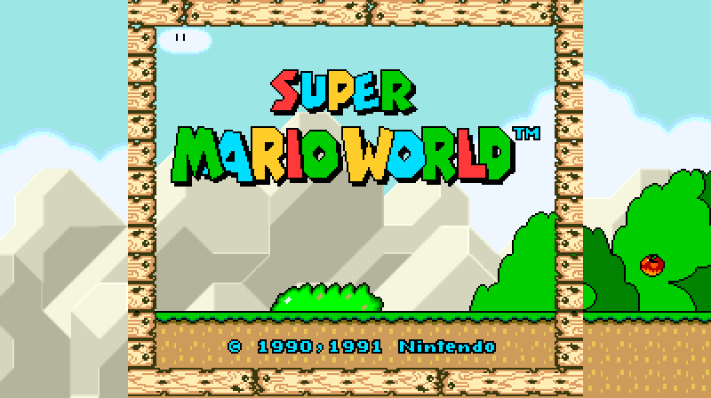
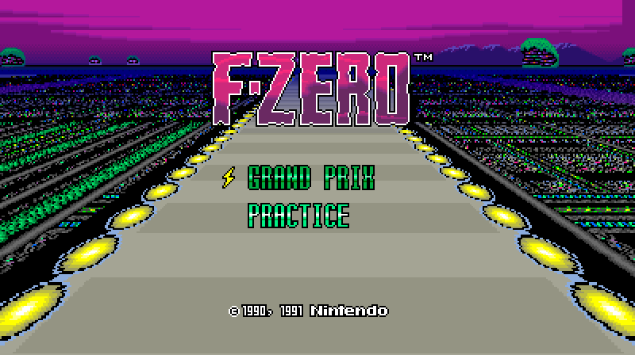
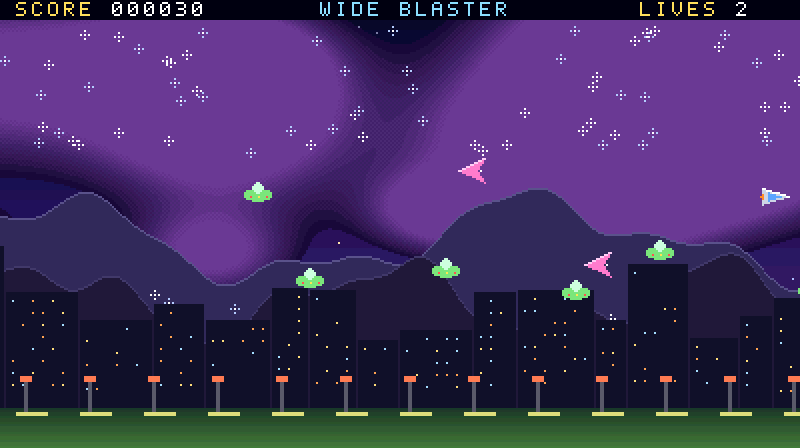
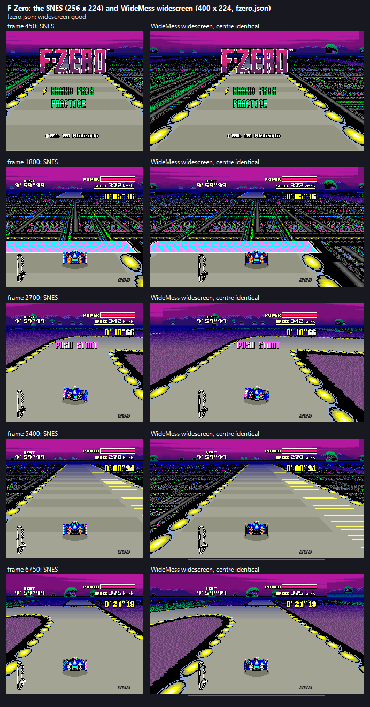
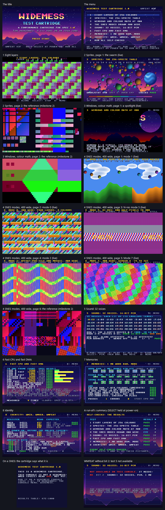

# WideMess

WideMess is BrokenNes's souped-up SNES fantasy console.
- The plan: `docs/projects/widemess-plan.md`.
- The hardware contract, spec v1: `docs/projects/widemess-spec.md`.

- Making a game for it, the devkit (milestone 5): `docs/projects/widemess-devkit.md`; the devkit itself is `BrokenDev/widemess/`.
- **The test cartridge**, a conformance cartridge any WideMess (BrokenNes, a C++ port, an FPGA core) can run: `testcart/README.md`. In the desktop app: Console > WideMess test cartridge.

This folder holds what is built for WideMess outside the emulator code.

| Path | What |
|---|---|
| `testroms/layers/` | Test ROM 1, eight layers of 256 colours at 400 x 224 (65816 assembly, WLA-DX), with its negative control. `build.ps1` builds both into `testroms/bin/`. |
| `testroms/picture/` | Milestone 2's test ROMs: `sprites`, `windows`, `widesnes`. One 65816 register player (`player.asm`) plays the script of register writes, DMA and HDMA that `gen_picture.py` generates for each scene; the same writes drive the generator's own model of spec section 3, which draws the picture each ROM must produce (`<rom>.expect.png`). `build.ps1` builds the ROMs, their negative controls and the pictures into `testroms/bin/`. |
| `testroms/sound/` | Milestone 3's test ROM, the sound chip: a 65816 program (`sound.asm`) and an SPC700 program (`spc.asm`), WLA-DX; `gen_data.py` makes the samples, the DMA jobs, the SPC700's step lists and the manifest the checks measure against. `build.ps1` builds it and its negative control into `testroms/bin/`. |
| `testroms/cpu/` | Milestone 4's test ROMs (WLA-DX; `build.ps1` builds them into `testroms/bin/`): `speed.asm`, the fast CPU and fast DMA measured against the spec's cycle model, with its no-unlock control; `bigmap.asm` + `gen_bigmap.py`, a 4 MB game on the WideMess map (1 MB work RAM, the 20-bit WRAM port, 256 KB battery RAM, 64 ROM banks). |
| `profiles/` | Milestone 6: the SNES games' enhancement profiles (spec section 6.2, format `widemess-profile-1`), one JSON file per game, found by the ROM image's SHA-1. The desktop app and Workshop ship them beside the program; BrokenNes Lite builds them into the app (milestone 7a). |
| `sample/` | Milestone 5's sample game, **Wide Blaster**, made with the devkit (`brokendev new widemess widemess-sample`): C and 65816 on PVSnesLib with the WideMess extensions, its PNG, WAV and MIDI sources and `wms.json`. BrokenDev project `widemess-sample`. |
| `testcart/` | **The WideMess test cartridge**: one cartridge whose menu runs the eight tests live (eight layers, sprites, windows and colour math, the SNES modes 400 wide, the 32 voices, fast CPU and DMA, the memories, identity), judges itself and keeps its results in a table at `$7E:1000`; SELECT held at power-on runs every self-check. 65816 and SPC700 (WLA-DX) with `gen_testcart.py`; `build.ps1` builds it into `testroms/bin/`. BrokenDev project `widemess-testcart`. Its conformance: `testcart/README.md`. |
| `testroms/devkit/` | Milestone 5's test ROMs: `build.ps1` builds the devkit's template and the sample game, each with its negative controls, into `testroms/bin/` with BrokenDev's devkit. |
| `testroms/bin/` | The built test ROMs: `devkit_template.wms`, `devkit_template_nounlock.wms`, `devkit_sample.wms` (+ `.sym`), `devkit_sample_nounlock.wms`, `devkit_sample_snesspeed.wms`, `devkit_sample_noclear.wms` (+ `.sym`: the sample without the start-up's work-RAM clear, for `--check-test`); `layers.wms`, `layers.sfc` (the same game as a SNES image) and `layers_nounlock.wms` (the negative control); `sprites`, `windows`, `widesnes` (`.wms`, `_nounlock.wms`) with the model's pictures (`.expect.png`, `_nounlock.expect.png`, `.<variant>.expect.png`); `sound.wms`, `sound.sfc`, `sound_nounlock.wms` and `sound.json` (the manifest); `speed.wms`, `speed.sfc`, `speed_nounlock.wms`; `bigmap.wms` (its controls, cut to 2 MB or on the HiROM map, are made by `--wms-test`); `widemess-testcart.wms` (the test cartridge), `.sfc` (its SNES image), `.sym`, `.json` (its pages and results table, for harnesses) and its 20 reference pictures (`widemess-testcart.<page>[.<variant>].expect.png`). |

**The emulator side** is in `Windows/NesEmulator/snes/`:
- `WideMess.cs`: the unlock and registers (`WmsExtension`), the `.wms` file (`WmsFile`) and the picture chip (`PPU_WMS`).
- `WideMess.Picture.cs` (milestone 2): `PPU_WMS`'s wide compositor, one for the WideMess mode and the SNES modes drawn 400 wide (main and sub
  screens, windows, colour math), both sprite tables and the registers `$21A0-$21BF`.
- `WideMess.Sound.cs` (milestone 3): the sound chip `APU_WMS` (an `APU_SFC` subclass: the sound RAM above 64 KB and the port `$21F0-$21F3`), and
  `DSP_SFC.WideMess.cs`: the S-DSP's voices 8-31 and its second register page.
- `WideMess.Memory.cs` (milestone 4): the WideMess map's limits and the cartridge a `.wms` file becomes (`SnesCartridge.LoadWideMessMap`).
- `BOARD_SFC.WideMess.cs` (milestone 4): fast mode, the 1 MB work RAM and its 20-bit WRAM port, fast DMA; and (milestone 6) `ConsoleFastCpu`, the
  console's fast CPU for a locked SNES game.
- Milestone 6, SNES games enhanced: `WideMess.Enhance.cs` (the enhanced line of a locked SNES game on `PPU_WMS`: the side rules, masks, the sprite pass
  with the SNES's own count), `WideMess.Profiles.cs` (the profile format and the profiles folder), `DSP_SFC.Enhance.cs` (cubic interpolation), and
  `Windows/NesEmulator/systems/SnesSession.Enhance.cs` (the four switches, "use the profile", the unlock taking them away).
- The hooks in `BOARD_SFC.cs`, `PPU_SFC.WideMess.cs` (read-only views of the SNES chip's registers; the SNES chip's own drawing is untouched), `DSP_SFC.cs` (one
  test a sample) and `APU_SFC.cs` (`$F3` with `$F2` at `$80-$FF`).
- The console is registered in `Windows/NesEmulator/systems/ConsoleSystems.cs` (key `wms`).
- It runs on `SnesSession` with `wideMess: true`.

## Tools (BrokenNes Workshop)

```
BrokenNes.Workshop.exe --wms-test  [--roms WideMess\testroms\bin] [--snes "a.sfc;b.smc"] [--frames 900] [--reference-paths]
BrokenNes.Workshop.exe --wms-pack  --in game.sfc --out game.wms [--title T] [--features 1] [--map 0|1|2] [--sram BYTES] [--battery]
BrokenNes.Workshop.exe --wms-shot  --rom game.wms --out shot.png [--frames 60] [--scale 3] [--console wms|snes] [--wide]
BrokenNes.Workshop.exe --wms-sheet --rom game.wms --out sheet.png [--frames 120]
BrokenNes.Workshop.exe --wms-run   --rom game.wms [--frames N] [--input "f:Buttons,..."] [--png-at f,...] [--out-dir d] [--voices] [--wram ADDR:LEN] [--ram-trap] [--trap-pc BBXXXX]
BrokenNes.Workshop.exe --wms-enhance-sheet (--game KEY | --rom game.sfc [--input SCRIPT]) --out sheet.png [--at F1,F2] [--no-flicker] [--all-extend] [--scratch-profile p.json]
BrokenNes.Workshop.exe --wms-enhance-film  (--game KEY | --rom game.sfc [--input SCRIPT]) --out film.png [--every 300] [--frames 6000] [--fast-cpu]
BrokenNes.Workshop.exe --wms-enhance-test  [--roms DIR] [--snes-dir DIR] [--enhance-games KEY;KEY] [--profiles DIR]
BrokenNes.Workshop.exe --wms-fast-probe    --rom game.sfc [--frames 300] [--from 0] [--every 10]
BrokenNes.Workshop.exe --enhanced-test --only wmsmenu,wms,wmsown,wmsgames
BrokenNes.Workshop.exe --wms-guest-sheet --out dir [--only "name,name"] [--scale 2]
BrokenNes.Workshop.exe --wms-testcart [--roms WideMess	estromsin] [--reference-paths]
BrokenNes.Workshop.exe --wms-testcart-shots --rom WideMess	estromsin\widemess-testcart.wms --out dir
```

- `--wms-test` runs the milestones' checks, each with a negative control (milestone 3's sound checks are its sections S1-S6). With `--snes`, it also runs each SNES game frame for frame on the SNES
  console and on the WideMess console and requires identical pictures and sound; then draws each game 400 wide (WIDE set on the chip, the game
  itself still locked) and requires every line's columns 72-327 to be the SNES chip's own line. `--reference-paths` turns the SNES chips' fast
  paths off.
- `--wms-pack --map 2` packs a WideMess-map ROM; `--sram` is its battery RAM in bytes and `--battery` makes it the game's save.
- `--wms-shot --wide` draws a SNES game's modes 400 wide, the way the wide SNES modes show it.
- `--wms-sheet` draws the 400-wide picture and each of the 8 layers alone.
- `--wms-run` (milestone 5) runs a game and reports what it uses (unlocked, picture, layers drawing, sprites on the picture, fast CPU and DMA,
  work RAM above 128 KB, voices sounding: the measure BrokenDev's `verify` checks), the sound unit, the audio and the hottest PCs; `--voices`
  lists the voices' registers and the WideMess directory, `--wram` dumps work RAM, `--ram-trap` / `--trap-pc` stop at a crash and list the
  instructions before it.
- `--wms-enhance-sheet` (milestone 6) draws a SNES game's contact sheet: the SNES picture beside WideMess widescreen with the game's profile, at several
  moments of one run (widescreen leaves the game as it is, so the SNES chip's own line is drawn beside every enhanced line and compared). `--game` is one
  of the proven games (`smw`, `yoshi`, `dkc`, `sm`, `alttp`, `fzero`, `smk`, `ct`, `mmx`, `contra3`, `scv4`: their pad scripts and moments are in
  `Workshop/WideMessCli.Enhance.cs`). `--all-extend` draws every layer extended instead of the profile's rules.
- `--wms-enhance-film` draws the wide picture every N frames and prints each moment's register set-up per band of rows (for writing a profile).
- `--wms-enhance-test` runs milestone 6's checks alone; `--wms-test` runs them after the others. The proven games are read from `--snes-dir`
  (default `X:\EMULATION\Super Nintendo\Super Nintendo (U)`); a game not found there is skipped.
- `--wms-fast-probe` switches the console's fast CPU on at a frame and prints the 65816's PC beside the SNES console's (`--trace-ports`: the sound-port
  writes of both runs, where they part and what the other run writes next).
- `--wms-side-truth --game KEY --layer bg1 [--scratch-profile p.json | --all-extend] [--detail N]` (milestone 6 follow-up): how true a layer's side
  columns are, judged by the SNES picture when the place scrolls into it. Since the milestone 6 climb it works per line (only the lines of the layer's
  main scroll; blank top lines and splits are left out), follows the vertical scroll, takes the truth 8 columns inside the SNES edge (`--truth-margin`),
  reports how much of the sides the layer draws, and the map memory's and the level's counters; `--no-level` takes the profile's level away (a control).
- `--wms-level-probe --game KEY --at F1,F2 [--find]` (milestone 6 climb): research for the level in work RAM. Without `--find` it checks Super Metroid's
  layout (`--blocks`, `--width`, `--tiles` to try others); with it, it searches work RAM for any block table (8 bytes, a 2 x 2 group of the picture) and a
  block map of bytes or words that names those blocks.
- `--enhanced-test --only wmsmenu,wms,wmsown,wmsgames` (milestone 7b) checks the WideMess chips on the other consoles' menus (docs/projects/enhanced-cores.md section 6);
  `wmsgames` needs the user's library (X:\EMULATION, the local Sega roster) and `wmsown` the test ROMs here (run it from the repository).
- `--wms-guest-sheet` (milestone 7b) draws contact sheets of other consoles' games on the widescreen chip beside their own picture.
- `--wms-testcart` runs the test cartridge's checks alone (section TC of `--wms-test`): its run-all read from its results table, its claims measured from outside,
  every picture page against its reference picture, its negative controls. `--wms-testcart-shots` draws every screen of it and a contact sheet.
- Workshop is a GUI-subsystem program. In PowerShell, run it with `Start-Process -Wait -NoNewWindow -RedirectStandardOutput`.

The desktop app's own check is `UAT/entrypoints/widemess-desktop-smoke.ps1 -Exe <BrokenNes.Windows.exe>`. It uses a scratch settings folder.

Milestone 7a's checks: BrokenNes Lite's is `UAT/entrypoints/lite-widemess.ps1 [-Publish <AOT publish folder>]` (it publishes the AOT build itself otherwise; `UAT/lite/test-lite-widemess.mjs` in
Edge over the DevTools protocol); the FL plugin's are the self-test's `wms` and `rom-wms` (`FruityHost selftest <dll> --only wms,rom-wms`, see `Plugin/CLAUDE.md`). How WideMess appears in
each host is spec section 9.

## Milestone 1 result (2026-10-24)

- **`--wms-test`: 21 of 21 checks pass.**
  - The test ROM unlocks WideMess and draws 400 x 224 with 1,020 colours.
  - Each layer alone shows all 255 colours of its bank.
  - The layers scroll.
  - A save state round-trips.
  - The negative controls hold:
    - registers written without the unlock change nothing;
    - on a SNES the ROM sees no WideMess;
    - the loader refuses damaged, cut and too-new files, and files needing missing features, and says why.
- **8 SNES games run frame-for-frame identical (picture and sound, 900 frames each) on the SNES and WideMess consoles:** Super Mario World,
  A Link to the Past, Star Fox (Super FX), Super Mario RPG (SA-1), Pilotwings (DSP-1), F-Zero, Super Metroid and Donkey Kong Country.
- **The desktop app smoke test passes 7 of 7.**

## Milestone 2 result (2026-10-24): the picture, complete

**What it is.** Spec section 3 (3.1-3.4) and, in `PPU_WMS`, one wide compositor for the WideMess mode and the SNES modes drawn 400 wide:
- the SNES modes 0-7 at 400: layers past the SNES's 256 columns, offset-per-tile, mosaic, hi-res averaged to 400, Mode 7 continued to both edges;
- sprites: the SNES table across 400, or the WideMess table (256 sprites, 64 a line, 8 x 8 to 64 x 64, 4 or 8 bpp, 10-bit X, slots between the 8 layers);
- windows (9-bit positions, or the SNES's at the SNES picture's place) and colour math, main and sub screens, in both.




**How it is tested.** `testroms/picture/gen_picture.py` holds a second implementation of spec section 3, in Python. Each scene's register writes
go both into the ROM's script and into that model, and the model draws the picture the ROM must produce. Workshop compares BrokenNes's picture
with it pixel for pixel.

| Scene | What the ROM draws | Its pictures (`testroms/bin`) |
|---|---|---|
| `sprites` | The WideMess table at 400: 16 sizes, 4 and 8 bpp, flips, X = -512 / -64 / -63 / -8 / 380 / 396 / 400 / 511, Y = -8 / 216, table order over priority, `WMOBJPRI` slots, 70 sprites on a line (64 drawn), 30 sprites 64 wide on a line (128 slivers drawn), `WMOBJSTAT`. | the ROM; the no-unlock control; `WMOBJ` off (the SNES table, X centred); the WideMess mode 256 wide |
| `windows` | 9-bit windows (window 1 shaped line by line by HDMA), OR / AND / XOR / XNOR / inverted for BG1-BG8, main and sub masks, add / subtract / half, sub screen, fixed colour, clip to black, math region, the per-sprite math bit. | the ROM; the no-unlock control; the SNES's `WH0-WH3` at 400 |
| `widesnes` | Bands of mode 1, mode 0, hi-res mode 5, mode 2 (offset-per-tile with mosaic) and Mode 7 drawn 400 wide (HDMA on `BGMODE`, `MOSAIC`, `BG3VOFS`): a 64-wide map's both halves, a 32-wide map repeated, offset-per-tile columns left of the SNES edge, the SNES table across 400 (X = 0 / 255 / 256 / 300 / 327 / 328 / -72 / -100), SNES windows with an edge on the SNES edge. | the ROM; the no-unlock control (it must equal the wide picture's columns 72-327); 9-bit windows; the WideMess table in a SNES mode |

**Results.**
- **`--wms-test`: 43 of 43 without games; 70 of 70 with the 9 SNES games** (Super Mario World, A Link to the Past, Star Fox, Super Mario RPG,
  Pilotwings, F-Zero, Super Metroid, Donkey Kong Country, Chrono Trigger):
  - every test-ROM picture, control and variant is pixel-exact against the model;
  - three deliberate bugs planted to test the tests (sprite v-flip, the XNOR window, the SNES X split at 328) failed 8 checks between them, in all three scenes;
  - a save state carries the sprite table and the new registers;
  - milestone 1's 8-layer picture is unchanged (frame 61 hash `1977C01DE6BFDDE7`);
  - each game is frame-identical (picture and sound) on the SNES and the WideMess consoles;
  - drawn 400 wide, every line's columns 72-327 are the SNES chip's own line (fast and reference paths).
- **Coverage of the games drawn wide** (3,000 frames each, about 6 million lines, all identical in the centre): modes 1, 2 (offset-per-tile),
  3, 5 (hi-res), 7, mosaic, colour math, windows and sprites. The games check the centre only; the side columns are checked by the test
  ROMs' model (modes 0, 1, 2, 5, 7). Modes 4 and 6 drawn wide are exercised by no game and no test ROM yet; mode 3's sides only by the
  shared code path.
- **Speed in Workshop** (the whole console; the picture alone in brackets; best of two timings on a shared CPU): layers 489 fps (553),
  sprites 687 (957), windows 351 (341), widesnes 302 (730). Drawing allocates nothing. `--wms-test` gates at 90 and 120.
- **The SNES path is unchanged:** the SNES chip's own drawing is untouched; the ALttP speed-pass golden is IDENTICAL; an interleaved A/B
  against milestone 1's build (ALttP, 2,400 frames, 4 pairs) shows no slowdown (mean of medians 705 fps for milestone 1, 853 for this build:
  noise on a shared CPU, the code is the same).
- **UAT `run-suite.ps1`: 125 pass, 0 fail, 16 skip, 3 info.** Lite and the plugin's Core build (WideMess stays hidden there).
- **The desktop app smoke test passes 9 of 9**: it now also checks that the app shows `sprites.wms` and `widesnes.wms` exactly as the model draws them.
- **With milestone 4 merged** (WMFEAT `$3B`, state format `wms-3`): `--wms-test` 113 of 113 with all milestones' checks and the 9 games, the same
  on the reference paths; the ALttP golden IDENTICAL; desktop smoke 9 of 9; UAT 125 pass, 0 fail, 16 skip, 3 info; Lite and Core build.

## Milestone 3 result (2026-10-24): the sound chip

The design is spec section 4. In short:
- The main CPU's unlock unlocks the sound unit too.
- Voices 8-31 are three more banks of the S-DSP's voices in a second register page (`$F2` = `$80-$FF`, `WBANK`).
- Samples are BRR or 16-bit PCM, anywhere in 1 MB of sound RAM, from a 16-byte directory entry.
- The main CPU fills the sound RAM through `$21F0-$21F3`, with DMA.
- The new voices mix into the S-DSP's sums before its master volume and echo. The output stays 32 kHz.

**`--wms-test`: 71 of 71 checks pass** (milestone 1's 23, then 48 for the sound). With the nine SNES games of the rules, 80 of 80.
The sound ROM's checks measure the samples by FFT against the generator's manifest:
- **Each new voice alone:** frequency within 2 Hz, level within 4% (all 24 come out at 0.993 of the expected level), the pan, and a tone
  holding over 99% of the power.
- **All 32 at once:** 32 tones at the 32 frequencies, each within 0.19 dB of its level.
- **16-bit PCM against BRR** at pitch 1.0: harmonics at -68 dB against -29 dB.
- **The rest:** the echo with and without a voice's `WEON` bit, pitch modulation from the voice before, noise, a one-shot PCM sample, a
  ring the 65816 rewrites through the port while the voice plays it, and the playing-address registers.
- **Negative controls:**
  - The same program without the unlock: the new voices are silent, the S-DSP's 8 play, and the sound RAM above 64 KB is untouched.
  - That program on a SNES: bit-identical to it on the locked WideMess.
  - The SNES image on a SNES.
- **The rest of the machine:** a save state into a fresh session, bit-identical; the menu (WMS first) and the swap to SFC, which says so;
  0 bytes allocated over 60 frames of 32 voices.
- **Shown able to fail:** 9 deliberate bugs, each caught. They were:
  - 16-bit addresses;
  - PCM read as BRR;
  - no echo for the new voices;
  - no pitch modulation;
  - the loop bit ignored;
  - a state without the sound RAM;
  - the unlock not reaching the sound unit;
  - the port live while locked;
  - the second page readable while locked.

**SNES games stay SNES:**
- The nine games are frame-identical on both consoles, sound included, and their sound hashes equal the build before milestone 3.
- The ALttP speed-pass golden is IDENTICAL.
- Interleaved A/B on ALttP gives the new build 1.006 times the old speed (best of 3, 12 rounds). The DSP takes 15.65% of the frame
  against 15.70% before.

**Cost:** 32 voices take about 33 ms of CPU a second of sound (the S-DSP's 8: 10 ms).

**The desktop app smoke test passes 8 of 8** (a new step: the sound ROM runs on APU WMS, unlocked).

**Merged with milestones 2 and 4** (WMFEAT `$3F`, state format `wms-4`):
- `--wms-test` passes 136 of 136, and 163 of 163 with the nine SNES games, also with `--reference-paths`.
- The games' sound hashes are still the ones from before milestone 3, and the ALttP golden is IDENTICAL.
- The desktop smoke passes 10 of 10. Lite and Core build.
- The plugin self-test passes 64, with 1 warning (QLQ +1200 cents) and 0 failures. It ran on the branch merged with milestone 4.
- UAT: 125 pass, 0 fail, 16 skip, 3 info.

  From a git worktree, the suite's story and 65-o-borked ROMs exist only in the main checkout's ignored build folders, so 44 more cases skip
  there; they were linked in for this run.

**Open:**
- An SPC700-side window on the RAM above 64 KB (none now: the main CPU fills it).
- The plugin and Lite keep WideMess hidden until milestone 7.
- No sound driver yet (milestone 5).

## Milestone 4 result (2026-10-24): CPU and memory

- **`--wms-test` checks M4.1-M4.6 pass** (64 checks in all with milestone 1's), the same on the reference paths (`--reference-paths`).
  - Fast mode: the speed ROM's loops run the iterations the spec's cycle model predicts, to one iteration (loop A 3,208 a frame at SNES speed,
    12,386 fast: 3.86x; loop B, with one I/O read, 2,407 and 7,539: 3.13x). From FastROM, loop A runs 3,610 at SNES speed (the 96-clock
    prediction) and the same 12,385 in fast mode: `MEMSEL` does nothing there.
  - Fast DMA: 5,632 bytes a vblank in 512-byte transfers, 10,752 with fast DMA; fast CPU alone leaves DMA as it was.
  - The WideMess map: a 4 MB game with 256 KB of battery RAM finds all 64 ROM banks and their mirrors, the 1 MB work RAM over `$70-$7F`
    (A bus, 20-bit WRAM port, DMA both ways), and its battery save comes back in a new session.
  - Save states carry the new work RAM, the 20-bit port and fast mode. The new paths allocate nothing.
  - The negative controls hold: locked, the speed ROM measures exactly what a SNES does; a LoROM cartridge has no work RAM at `$70-$7D` and a
    17-bit port; the 4 MB game cut to 2 MB loses banks 32-63; on the HiROM map it finds ROM, not RAM; the loader refuses map-2 files the
    map cannot hold, and maps 0 / 1 that disagree with their image.
- **SNES games stay SNES:** the 9 games of the milestone (Super Mario World, A Link to the Past, Star Fox, Super Mario RPG, Pilotwings,
  F-Zero, Super Metroid, Donkey Kong Country, Chrono Trigger) are frame-for-frame identical on both consoles; the speed-pass goldens are
  unchanged with and without the reference paths; SNES speed is unchanged (interleaved A/B).
- **UAT 125 pass, 0 fail** (16 skip, 3 info); the desktop smoke test passes 7 of 7; Lite and Core build.
- Not covered by a test ROM: HDMA tables in the new work RAM (HDMA reads it through the same path as DMA, which is tested), and the old joypad
  ports' 12 clocks in fast mode (the I/O rule is tested through `$4214`).

## Milestone 5 result (2026-10-24): the devkit

**What it is** (the guide: `docs/projects/widemess-devkit.md`; the code: `BrokenDev/widemess/`):
- **PVSnesLib with WideMess extensions:** `widemess.h` (every register of the spec, the unlock and ID check) and a library in C and 65816 for
  the 8-layer mode, the video RAM and colour ports, the 256-sprite table, fast CPU and DMA, the 1 MB work RAM and the sound RAM port; the
  WideMess map's memory setup (`wmshdr.asm.in`: PVSnesLib's HiROM map, far RAM in banks `$70-$7D` through its SLOT 3).
- **Converters:** `wmsgfx.py` (PNG to 8-bpp layers and 4/8-bpp sprites, one palette of up to 1,024 colours, a video RAM layout and an upload
  table), `wmssnd.py` (WAV to 16-bit PCM or BRR through PVSnesLib's snesbrr, MIDI to songs with drum kits, effects, the whole sound RAM image).
- **A sound driver** for the 32-voice chip (`driver/wmsdrv.asm`, SPC700): songs on 24 channels (voices 8-31), effects on any voice, loaded
  through the sound RAM port.
- **`brokendev new widemess <name>`**, the template, and WideMess projects in BrokenDev: `build`, `verify` (with `expect.wms` checks), `run`,
  `compat` (BrokenNes's column only).
- **The sample game, Wide Blaster** (`sample/`): 8 layers in parallax, up to 199 sprites with a 64 x 64 256-colour boss, a song on up to 12 of
  the new voices with 16-bit PCM and BRR, fast CPU and DMA, its pools and a 64 KB recorder in the far work RAM.



**How it is tested.** The devkit's ROMs are built by the devkit (`testroms/devkit/build.ps1`) and measured from outside the game
(`WideMessCli.Measure`: the console's state, each layer drawn alone, the WideMess sprite table, the voices' envelopes through the DSP's second
page, the work RAM above 128 KB).

| `--wms-test` | What it shows | Its negative control |
|---|---|---|
| M5.1 | the template unlocks, draws 400 x 224 in the 8-layer mode with its 3 layers and its sprite, plays its song on voices 8-31 (243 of 300 frames), runs in fast mode with far RAM in use | M5.2: the same template built with `-D WMS_NOUNLOCK` (every WideMess register written, locked): 256 wide, no layer, no sprite, no voice, one colour |
| M5.3 | the sample draws 8 layers, 147 sprites on the picture (more than a SNES table's 128), up to 12 of voices 8-31 at once (more than the S-DSP's 8) in 881 of 900 frames, fast CPU and DMA, 3.7 KB of far RAM, and its main loop keeps 60 frames a second (game_frame 888 after 900 frames) | M5.4: the sample without the unlock (nothing), the template against the sample's thresholds (3 layers, 1 sprite, 4 voices: the checks say no), the sample at SNES speed (game_frame 439 after 900: fast mode is what keeps it at 60) |

- **BrokenDev's tests** (`BrokenDev/tests/run-tests.ps1`, section *widemess devkit*): WideMess manifests and their refusals, `new widemess` and
  its refusals, a missing project folder refused, `wmsgfx`'s 8-bpp tiles byte-identical to gfx4snes's (one changed byte caught), flip
  deduplication, colour limits refused, PCM groups and BRR blocks, 24 notes at once built and 25 refused, a pitch above 4x refused, and a
  project made by `new` built with PVSnesLib that passes `verify` while its no-unlock build fails every WideMess check. 115 passed, 0 failed,
  0 skipped.
- **`brokendev verify widemess-sample`** passes (8 layers, 147 sprites, 12 voices, 830 of 840 frames sounding); `compat` works on BrokenNes, with
  game_frame changing on every frame of 600-900.
- **The existing BrokenDev projects** with this BrokenDev (the user's workspaces and his BrokenDev home only read): dry-run builds of all seven
  pass; `verify` of his own built ROMs gives every checkpoint hash of his records for vrun-nes, vrun-nested, vrun-nested-enhanced, smb1-nes and
  smb1-nested, and passes for supervrun (his record is of an older ROM); real builds of vrun-nes and supervrun in scratch copies of the
  workspaces pass, supervrun byte-identical to its reference md5, and verify.
- **Emulator changes:** none in the chips. `PPU_WMS.MainLayers` (a read-only view of `WMTM`, for the measure); Workshop's `--brokendev verify`
  and `run` take console `wms`.
- **The whole branch** (milestones 1-5, main 43edc4d merged): `--wms-test` 153 of 153, the same with `--reference-paths`; UAT `run-suite.ps1`
  125 pass, 0 fail, 16 skip, 3 info; the desktop smoke test 10 of 10; `brokendev run widemess-sample` opens it in the desktop app (console
  `wms`, unlocked, 400 x 224, 61 fps); Lite, the plugin's Core and the desktop app build.

## Milestone 6 result (2026-10-24): SNES games enhanced

**What it is** (spec section 6). A SNES game on the WideMess console can have four enhancements. They are the console's: the game stays
locked and reads exactly what a SNES gives it, `STAT77`'s sprite flags included; only fast CPU changes its timing, by nature.
- **Widescreen** (needs the game's profile): 400 x 224. The centre 256 columns are the SNES picture; the 72 columns either side come from what
  the game keeps in video RAM, per layer: **extend**, **repeat** or **fill**. Masks (rows, a band of the sides, layers, fill / repeat / black,
  optional scene conditions on the SNES registers) handle HUDs, title screens and the like. Sprites are extended (their side parts drawn in
  addition, never counted) or filled.
- **No sprite flicker**: the SNES sprite table at WideMess's limits, 64 sprites and 128 slivers a line; a line within the SNES's 32 / 34 is
  drawn exactly as on the SNES.
- **Better sound**: 4-point cubic interpolation instead of the S-DSP's Gaussian, for what is mixed only (`OUTX` and pitch modulation stay
  the S-DSP's).
- **Fast CPU**: spec 2's fast mode, forced by the console. Switch it on after the game has started (spec 6.1); it is never kept.
- **Profiles**: `WideMess/profiles/*.json` (`widemess-profile-1`), found by the image's SHA-1, every key checked. A game without a
  profile is told so (no widescreen; the other three marked "not verified").
- **Desktop**: Console > **WideMess enhancements** (the profile line, "Use the profile", the four switches with the profile's verdicts,
  "Known issues..."), kept per game. **HTTP API**: `GET/POST /api/widemess/enhance`, `POST /api/widemess/profile` (a scratch profile,
  memory only).

**The games proven** (spec 6.4). Each contact sheet shows the SNES picture beside WideMess widescreen at five moments of one run, the
centre compared line by line.

| Game | Widescreen | No flicker | Fast CPU | Sheet |
|---|---|---|---|---|
| Super Mario World | good | 0 lines changed | risky (hangs if on at power-on) | `m6/smw.png` |
| Super Mario World 2: Yoshi's Island | risky (BG1 drawn: the old tiles are gone, the hills show there) | 18 lines | risky | `m6/yoshi.png` |
| Donkey Kong Country | **good** (BG1 drawn: no old tile, the jungle behind shows ahead of DK) | 0 | risky | `m6/dkc.png` |
| Super Metroid | risky (BG1 drawn: no stray tiles beyond a room's walls, the sides mostly empty) | 0 | risky | `m6/sm.png` |
| A Link to the Past | risky (indoor rooms beside rooms) | 0 | risky | `m6/alttp.png` |
| F-Zero | good | 0 | risky | `m6/fzero.png` |
| Super Mario Kart | good | 0 | risky | `m6/smk.png` |
| Chrono Trigger | unavailable (measured: drawn leaves 85% of the sides empty) | 0 | broken (times itself by the beam) | `m6/ct.png` |
| Mega Man X | risky (BG1 drawn; flat colour until the game draws there) | 254 lines | risky | `m6/mmx.png` |
| Contra III | risky (BG1, BG2 drawn: no other part of the stage, the sides mostly empty) | 2,946 lines (`m6/contra3-noflicker.png`) | risky (with the sound-port guard) | `m6/contra3.png` |
| Super Castlevania IV | risky (BG1, BG2 drawn: no old tiles, the sides mostly empty) | 0 | risky | `m6/scv4.png` |

(The sheets are in `docs/projects/widemess-images/m6/`.)



**How it is tested** (`--wms-test`'s E checks, also alone as `--wms-enhance-test`), each enhancement against a negative control:
- E1 the profiles folder reads; 11 kinds of malformed profile are refused, each saying why; a broken file is reported for its game.
- E2 synthetic sprite scenes on the picture chip:
  - no flicker shows 40 sprites where the SNES drops 8, and leaves every line within the limits pixel-identical with `STAT77` unchanged;
  - widescreen draws the side sprites (X = -4, 260, 300) but not X = 256, the SNES's hiding place;
  - fill, masks and a black mask with a scene condition do what they say;
  - all off is the SNES chip's picture.
- E3 the S-DSP: a tone at a quarter of the rate comes out 1.57x stronger with the cubic than the Gaussian; a 1 kHz tone within 6%; off,
  bit-identical.
- E4 fast CPU on the locked speed ROM: 12,386 / 7,539 loops a frame (spec 2's fast-mode prediction) with `WMSPEED` still reading open bus;
  off, 3,209 / 2,407 (the SNES's).
- E5 who gets them: not a `.wms` game, not the SNES console, no widescreen without a profile; a SNES game that unlocks WideMess loses them,
  and its picture is then its own.
- E6 the eleven games in lockstep with the SNES console (above).
- E7 speed: widescreen + no flicker runs at 357-461 (SMW), 399-422 (F-Zero) and 466-553 (Super Mario Kart) frames a second in Workshop
  over the runs (a shared CPU), the picture alone 425-829; drawing allocates nothing.

**Results** (on the branch with milestones 3 and 5 merged, main `f1b8c9d`):
- **`--wms-test` 269 of 269** with every milestone's checks, the nine SNES games of the identity check (frame- and sound-identical on both
  consoles, and drawn wide with the centre identical) and milestone 6's E checks on the eleven games (252 of 252 before milestone 5's merge).
- **236 of 236 on the reference paths** (`--reference-paths`, the E checks on Super Mario World, F-Zero and Contra III).
- **The SNES path is unchanged:**
  - the ALttP speed-pass golden is IDENTICAL, on the fast and the reference paths;
  - an interleaved A/B against `f14f0c6` (ALttP, 2,400 frames, 4 pairs) gives 1.036, or 0.999 without the cold first pair: noise.
- **The desktop smoke test passes 15 of 15**, with the new M6 step.
- **UAT `run-suite.ps1`: 125 pass, 0 fail, 16 skip, 3 info.**
- Lite and the plugin's Core build (WideMess stays hidden there).
- In the real app, Super Mario World finds its profile beside the program; "use the profile" plus better sound gives 400 x 224 at the
  app's 60 fps.

**Open** (as left by milestone 6; see the follow-up below for what changed):
- Fast CPU's hang in Chrono Trigger and Contra III is not traced (Super Mario World's is: the game's own sound-driver timing).
- No flicker had little to do in this play: eight of the eleven games never went over the SNES's limits with visible sprites. A
  shoot-'em-up (Gradius III, R-Type III) would exercise it more.
- Games that stream their maps just past the SNES edge (Donkey Kong Country, Super Castlevania IV, Contra III) could look better with
  a direction-aware rule. Today's rules are static per scene.

## Milestone 6 follow-up (2026-10-25): fast CPU traced, the drawn side rule

**Fast CPU.** The three hangs were traced with the D1 debugger (Workshop `--debug ... --do "enhance fastcpu on; ..."`, a new shell command):
- **Contra III, fixed.** After its sound driver echoes `$FF` on port 0, the driver clears its input ports 147 master clocks later; a fast 65816
  wrote the next value (`$CC`) 80 clocks after the echo, so it was wiped and both waited forever. The console's fast CPU now has a
  **sound-port guard** (spec 6.1): every access to `$2140-$217F` starts one scan line of SNES timing (the board swaps in a second page table at
  SNES speeds, so it costs nothing per access), restarted by each port access. The game runs from power-on and switched on later.
  WMSPEED's own fast mode (a `.wms` game) has no guard.
- **Chrono Trigger, genuinely cannot run fast.** It times itself by the beam: its main loop latches the scanline (`$2137`, `$C0:5A46`) and
  starts loading the next scene only on lines 240 and later or before 72. At SNES speed it gets there on line 257, with fast CPU on line 238
  every frame, so the scene never loads. Its profile calls fast CPU broken with that reason.
- **Super Mario World at power-on, genuinely cannot.** The 31 ms between starting its driver and writing `$FF` are an 8 KB RAM clear with no
  port access: no guard can keep that at SNES time. Switched on after the title it runs (as before).
- What the guard costs, fast CPU switched on at each game's first moment: 0-2% of the time at SNES speed for most games, Super Castlevania IV
  5.2%, Super Mario World 9.8%, Donkey Kong Country 14.2% (they talk to their drivers a lot).

**Widescreen: the drawn rule.** A new BG side rule, `drawn` (with `drawnAhead`): the layer extends only where the game has drawn its map for
the place shown, else it is filled. The picture chip follows the layer's scroll and keeps the span the game has drawn (the picture's columns
each frame, plus `ahead` pixels on the side it scrolls towards, the map's width pushing the far end along, a cut starting again). Spec 6.1.
- **`Workshop --wms-side-truth --game KEY --layer bg1`** measures it: every side column a frame shows is a claim about that place of the layer,
  judged when the place scrolls into the SNES picture (right, empty or wrong), on the layer's own colours.

| Game, layer | Extended: wrong | Drawn: wrong (right / empty) | Profile now |
|---|---|---|---|
| Donkey Kong Country, BG1 | 49% | 0% (22% / 78%) | BG1 drawn, ahead 0: widescreen **good** |
| Super Metroid, BG1 | 87% | 0.6% (6% / 93%) | BG1 drawn, ahead 0 |
| Super Castlevania IV, BG1 / BG2 | 68% / 50% | 0% / 0% | both drawn |
| Contra III, BG1 / BG2 | 34% / 100% | 0% / 0% | both drawn |
| Mega Man X, BG1 | 59% | 0% (9% / 91%) | BG1 drawn |
| Yoshi's Island, BG1 | (scroll changes within a frame: not measurable) | | BG1 drawn (the sheet shows the old tiles gone) |
| Chrono Trigger, BG1 / BG2 | 78% / 9% | 0% / 6%, 85% / 67% empty | stays unavailable: nothing true to show |

- Only Donkey Kong Country becomes **good**: its jungle (BG2, already true) shows behind the level where the game has not drawn. In the
  others the drawn rule trades wrong tiles for empty sides, which is honest but not yet good widescreen: they stay risky.
- A Link to the Past is unchanged: outdoors both layers are true when extended (BG1 100% right), and drawn would empty them; its indoor
  rooms still show the rooms beside them. A scene condition could tell them apart (Link's house has `CGADSUB` `$B3`, the rainy outdoors `$72`)
  but the checked play sees one room only, so that is not proven.
- Sheets re-drawn in `docs/projects/widemess-images/m6/` (dkc, sm, scv4, contra3, mmx, yoshi).

**Checks added** (each with a negative control): E1 (drawn profiles read; drawn sprites, a stray `drawnAhead`, an out-of-range one refused);
E2b (a synthetic streaming game: extended shows old tiles, drawn none, both directions, a cut); E4b (a synthetic sound handshake: completes on
the SNES, with fast CPU off and with the guard; without the guard the `$CC` is lost; the speed ROM never enters the guard); E6 now reports each
game's guard share; E8 (side truth on Donkey Kong Country and Super Metroid, every layer extended as the control).

**Results** (branch on main `ad4d81c`): `--wms-test` 306 of 306; `--debug-test` 101/0; `--check-test` 111/0; `--snes-state-test` 147/0; UAT `run-suite.ps1` 125 pass, 0 fail, 16 skip, 3 info; the
ALttP speed-pass golden IDENTICAL; interleaved A/B against `ad4d81c` (ALttP 2,400 frames, 10 pairs, CPU time) 0.991: noise; Lite, Core and
the desktop app build.

**Found along the way** (reported, not WideMess): two game screenshots are committed at the repository root
(`Super Mario World (U) [!]_snes_f01500.png`, a Link's Awakening DX one), added by BrokenDev D4's commit `5c0186b`; removed from git on 2026-10-25, and the repository root now ignores such screenshots.

## Milestone 6 climb (2026-10-25): from empty sides to true ones

The drawn rule had traded wrong tiles for empty sides. This round tried to fill them with true content, measured by `--wms-side-truth` (right / empty /
wrong per side column). Spec 6.1 (the map memory, the level in work RAM) and 6.3 (the tool).

**The tool, second version.** It now works per line: a frame's claims and truths are only the lines of the layer's main scroll (Yoshi's Island blanks
its top lines every frame, so the first version could not judge one frame of it), it follows the vertical scroll (claims are judged on the world rows
both show), and it takes the truth 8 columns or more inside the SNES edge, where games have finished drawing a column that scrolls in (at the edge
Super Metroid's BG2 is still being drawn). It also says how much of the sides the layer draws on every frame. All numbers below are this version's
(the first version's are in the follow-up above; Contra III's BG2, 100% wrong there, is 100% right of 212 columns here, on too little play to change
its rule).

**The map memory** (`memory`): the console remembers the map entries the SNES picture showed of a drawn layer, by place in the level, and draws a
side column outside the drawn span from it; forgotten at every cut, after a frame without the layer, and when the game's map disagrees with it (more
than 1 in 8 of at least 64 compared places, checked before the frame is drawn). Synthetic checks E2c with controls (without it the sides are empty;
without the disagreement cut a new level at the same scroll leaves the old one in the side). On the games it is honest but small: the sides the
player sees are mostly the ones ahead, which the game has never shown. Yoshi's Island's level layer draws 16.9% of its side pixels instead of 7.6%
(10.8% right, 89.1% empty, 0.1% wrong: one column the game had changed 800 frames later); elsewhere it changes the judged numbers by 0-1.5 points.
Only Yoshi's Island's profile uses it.

**The level in work RAM** (`level`): Super Metroid keeps the whole room in work RAM as 16 x 16 blocks (`$7F:0002`, the width and height at
`$7E:07A5` / `$07A7`, the block table at `$7E:A000`). Its profile now says so, and the console draws the side ahead from the room, checked every
frame against the game's own picture (at least 200 map entries, at most 2% different) and searched again when it fails. Synthetic checks E2d with
controls (without it the side ahead is empty; an address one byte off is never verified; a room left behind in RAM is refused; trusting RAM without
the check shows the wrong room). `Workshop --wms-level-probe --find` searched every game's work RAM for such a layout.

| Game, layer | Every layer extended | The previous rule | Now | Profile |
|---|---|---|---|---|
| Super Metroid, BG1 | 6.7 / 5.2 / **88.0** | drawn: 10.7 / **88.7** / 0.6 | **level: 99.4 / 0.0 / 0.6** (verified on 2,807 of 2,808 frames) | **good** (was risky) |
| Super Metroid, BG2 | 96.3 / 0 / 3.7 | extended | unchanged | |
| Yoshi's Island, BG1 | 42.2 / 0 / **57.8** | drawn: 10.1 / **89.9** / 0.0 (first measured) | drawn + memory: 10.8 / 89.1 / 0.1 | risky |
| Yoshi's Island, BG2 | 72.7 / 0 / **27.3** (first measured) | extended | unchanged (drawn: 2.4 / 96.0 / 1.6) | |
| Donkey Kong Country, BG1 / BG2 | 9.5 / 0 / 90.5; 100 / 0 / 0 | drawn 17.8 / 82.2 / 0; extended | unchanged | good |
| Super Castlevania IV, BG1 / BG2 | 21.3 / 11.9 / 66.8; 15.2 / 37.4 / 47.4 | drawn 2.2 / 97.8 / 0; 0 / 100 / 0 | unchanged (memory: 2.4 / 97.6 / 0) | risky |
| Contra III, BG1 / BG2 | 58.5 / 15.5 / 26.0; 100 / 0 / 0 (212) | drawn 1.5 / 98.5 / 0; 0 / 100 / 0 | unchanged | risky |
| Mega Man X, BG1 / BG2 | 8.2 / 29.3 / 62.5; 35.4 / 60.2 / 4.4 | drawn 4.4 / 95.3 / 0.3; extended | unchanged | risky |
| Chrono Trigger, BG1 / BG2 | 8.5 / 4.6 / 86.9; 82.8 / 9.2 / 8.1 | drawn 4.9 / 95.1 / 0; 0.1 / 99.9 / 0 | memory: 6.4 / 93.6 / 0; 0.9 / 98.9 / 0.2 | unavailable |
| A Link to the Past, BG1 / BG2 | (0 judged); 91.9 / 0 / 8.1 | extended | unchanged | risky |

(right / empty / wrong, % of the side columns the SNES picture later showed, over each game's checked play.)

- **Super Metroid becomes good.** Its sides are the room, ahead of Samus too (sheet `docs/projects/widemess-images/m6/sm.png`; the same moments
  without the level: `m6c/sm-without-level.png`). The 0.6% wrong on BG1 is one place that changed between the side showing it and the SNES picture
  showing it 300 frames later (it is the same with the drawn rule alone); BG2's 3.7% is one room whose background changes 5-15 rows of a column over
  200 frames.
- **Why the others stay risky:** their block tables are not in work RAM. Mega Man X, Donkey Kong Country, Yoshi's Island and A Link to the Past keep
  them in ROM (none of their 2 x 2 groups is found in work RAM); Contra III and Super Castlevania IV keep pieces of their stage around
  `$7E:5000-$7E:6FFF` (a third of the groups); a level source that reads the ROM's tables (and each game's map format) would be the next step.
- **Chrono Trigger** keeps its block table in work RAM (188 of 188 groups, `$7E:B800` in the scene checked) and its maps as bytes in rows of 256 at
  `$7E:4000` and up; the level source reads only word maps whose size is in RAM, so this is a lead, not built. Its scenes hardly scroll, so what the
  sides would show beyond the camera's reach could not be judged by the tool anyway. It stays unavailable.
- **A Link to the Past indoors** is not proven. The play reaches two indoor scenes (Zelda's cell in the opening dream and Link's house), both with
  `CGADSUB` `$B3`, and the outdoors in the rain, `$72`: a mask on that would be a guess from two rooms. The game's own indoor flag is in work RAM, which
  scene conditions do not read (they read SNES registers); a condition on work RAM, like the level, would be the clean way. Left open.

**Checks added** (each with its negative control): E1 (the `memory` and `level` keys read and refused), E2c (the map memory, 7 checks), E2d (the
level in work RAM, 6 checks), E8 (Super Metroid's BG1 with its level at most 1% wrong and 5% empty; without it at least half empty), E7 (Super
Metroid with its level: speed and no allocation).

**Results** (the branch merged with main `0c03fe9`): `--wms-test` 331 of 331 (Super Metroid in lockstep with its level on: the centre identical
over 6,000 frames, `STAT77` and the sound identical, off frame-identical); `--check-test` 111/0; `--debug-test` 101/0; `--snes-state-test` 147/0;
UAT `run-suite.ps1` 125 pass, 0 fail, 16 skip, 3 info; the ALttP speed-pass golden IDENTICAL; interleaved A/B against `2128f42` (ALttP 2,400
frames on the SNES console, 10 pairs, CPU time) 1.02: noise (the SNES console's code is untouched); Core, Lite and the desktop app build.

## Milestone 7a result (2026-10-24): WideMess in BrokenNes Lite and in the FL plugin

How WideMess appears in each host, and why the plugin differs, is spec section 9.

**BrokenNes Lite** (the Blazor WebAssembly build; `WebLite/`, the facade `Windows/NesEmulator/board/Emulator.Consoles.cs` and `Emulator.WideMess.cs`):
- the Console menu has WideMess; `.wms` files open from the file input, drag and drop, the ROM manager and `?rom=`; a SNES game runs on the WideMess when it is selected
  and goes back to the SNES when the SNES is chosen (the game's own file decides, as on the desktop);
- the 400 x 224 picture is shown at its square-pixel 16:9 shape (the canvas and the page take 400 / 224);
- battery RAM in IndexedDB (`battery_v1:wms<sha1>.srm`; a SNES game on the WideMess keeps its SNES save), save states (`state_v1:wms:<game id>.quick`);
- the touch controller's SNES pad; the X / Y / L / R key hints;
- milestone 6's enhancements for a SNES game on the WideMess: a row beside the core menus (the profile line, Use the profile, the four switches with the profile's verdicts,
  the known issues), kept per game in IndexedDB (fast CPU never), the profiles built into the app;
- `WebLite/LinkerConfig.xml` roots `PPU_WMS`, `APU_WMS`, `WmsExtension` and `WmsFile` (they are built with `new`, so the trimmer keeps them anyway; the roots guard against a future
  lookup by name).

**The FL plugin** (`Plugin/README.md`, "The WideMess chip"; `Plugin/CLAUDE.md`):
- the WideMess sound chip is **chip 29, `WMS`**, appended after the six Presets chips on the SNES console (nothing before it moved);
- **Direct mode:** the chip itself (a private S-DSP with voices 8-31 attached and unlocked), 24 notes at once on one channel, from 14 built-in 16-bit PCM instruments (each
  waveform eleven band-limited one-cycle loops, one per octave);
- **ROM mode:** `.wms` games and SNES games on the WideMess console, 400 x 224 in the editor at 1x, the sound on Mix; the chip can be swapped under a running game;
- **Instrument Runaway** on an unlocked WideMess game plays the game's own 16-bit PCM and BRR samples (both directories; 24 notes at once on the new voices); a project keeps
  them (section `WMS1`).

**How it is tested.**

| Check | What it shows | Its negative controls |
|---|---|---|
| Lite `console`, `picture`, `layout` | the menu and cores (WMS, the SFC sound chip offered); 400 x 224 with 1,020 colours, moving; canvas 800 x 448, aspect 400 / 224; the SNES pad | |
| Lite `model` | `sprites`, `widesnes`, `windows`: the browser's frame is the spec model's PNG pixel for pixel | |
| Lite `control`, `snes` | `layers.sfc` on the WideMess finds it (400 wide) and on the SNES draws its red screen; Super Mario World on both consoles: 1,196 frames, picture and sound identical | `layers_nounlock.wms`: 256 x 224, black |
| Lite `sound` | `sound.wms` rms 0.088 at 32 kHz | the locked control 0.008 |
| Lite `saves`, `states` | `bigmap.wms`'s 256 KB battery RAM with its boot counter in IndexedDB, counting up in a fresh page; states of three WideMess games: the next 60 frames' pictures and sound equal, also in a fresh page | |
| Lite `enhance` | Super Mario World finds its profile; widescreen: 400 wide, the centre (columns 72-327) the SNES picture for 30 frames from one saved moment; kept per game, back in a fresh page; Use the profile = widescreen + no flicker | a `.wms` game has none (said, switches disabled); fast CPU not kept; the SNES console has no row |
| Lite `speed` | the AOT build in Edge, the frame call over three runs on a shared machine (the last run's with the picture drawn on the GPU in brackets): layers 160-196 (206), sprites 194-208 (202), windows 122-137 (95), widesnes 123-129 (119), Wide Blaster 110-121 (87) frames a second, p95 under 13 ms; Super Mario World on the SNES 205-207 | SwiftShader (the CPU draws): reported only |
| plugin `wms` | chip 29 and every earlier index; pitch A0-C8 worst 0.196 cent; the sine's harmonics below -100 dB; each instrument's harmonics on its formula; 24 notes = 24 frequencies in the mix, a 25th takes the oldest's voice; level 0.0 dB from the NES chip; 9x real time and 0 bytes with 4 x 6 sliding notes; Reset Console | deliberate bugs (8 voices; the pitch for the wrong loop) caught; the same chord on the SNES chip: 1 note |
| plugin `rom-wms` | a `.wms` file takes WMS from a NES emulator; 400 x 224 in the editor; `sprites` / `widesnes`: the plugin's picture hash = the PNG's; `sound.wms` rms 0.083; Super Mario World frame and sample identical on the SNES and WMS chips (10 pictures over 600 frames, 143,872 samples); a chip swap under a running game; Runaway lists 28 instruments (14 16-bit PCM and 12 BRR of the new voices' directory, 2 of the S-DSP's), plays the game's 1 kHz PCM sine at C5, A4, C6, a 6-note chord, 0 bytes; the project's `WMS1` | the locked control (0.008) and the SNES chip (no new voices, said); a damaged `WMS1` refused with a note; the locked control's Runaway is the SNES sampler's |

| Lite `testcart` | the WideMess row's Test cartridge button starts the built-in test cartridge on the WideMess console, 400 x 224 | |
| Lite `chips` | milestone 7b's chips, which follow the console into Lite: a NES game (VRUN) on the NES board's widescreen chip `WMSS` is shown whole, 400 x 240; Super Mario World on the route `WMS:WMSS` (picture and sound) is 400 wide and keeps its sound | |

**Results** (the branch merged with main f0af507: milestones 6, 7b, the debugger D1 and D4, the test cartridge):
- **The plugin's self-test: 67 results, 66 pass, the QLQ warning (the QLQ core plays an octave sharp on purpose), 0 failed** on main 4b3e643's merge (29.6 minutes; on f0af507's merge one full run had `record-nes` count 120 bytes in its first recorded block and `presets` a one-off 3,280-byte window, on a machine shared with other agents; both pass alone on the same DLL, 0 bytes; 65 before this milestone: `wms` and
  `rom-wms` are new; the chip-count assertions of `consoles`, `psg`, `md`, `fm`, `presets` and `editor` follow the appended chip).
- **Lite:** every suite passes on the AOT build: the WideMess suite (`lite-widemess.ps1`) 42 checks (with the test cartridge button), the SNES states 18, the d-pad 32, the Sega suite 137.
- **`--wms-test` 315 of 315** with the nine SNES games of the rules (Super Mario World, A Link to the Past, Star Fox, Super Mario RPG, Pilotwings, F-Zero, Super Metroid,
  Donkey Kong Country, Chrono Trigger: frame- and sound-identical on both consoles), milestone 6's and the test cartridge's checks; **315 of 315 with `--reference-paths`**.
- **UAT `run-suite.ps1`: 125 pass, 0 fail, 16 skip, 3 info.** The desktop smoke test passes 21 of 21.
- Nothing changes for the other consoles in Lite and the plugin: their suites and checks pass as before; the chip indexes 0-28 are where they were.

**Open:**
- Editing WideMess instruments in the plugin's Instruments tab (and presets of them, pushing them into the game): the tab says it is not built; Runaway plays them.
- The plugin's Record window records the S-DSP's 8 voices of a WideMess game, not the new voices; a WideMess game has no per-voice stems.
- A phone's speed in Lite is not measured (this machine's Edge: 110 frames a second at the slowest, Wide Blaster); nobody has listened to the plugin's built-in instruments.

## Milestone 7b result (2026-10-24): the WideMess chips on the other consoles

- **The widescreen chip** (`WmsWideChip`, `Windows/NesEmulator/mix/WideMessEnhanced.cs`) and **the WideMess sound chip** (`WmsVoiceChip`) are the **WideMess (enhanced)** entry of the picture and
  sound menus of the SNES, Game Boy, Game Boy Color, Master System, Game Gear and Genesis (route `WMS:WMSS`) and of the NES (the NES board's `PPU_WMSS` / `APU_WMSS`, id `WMSS`), only where the
  WideMess console is offered (the desktop app, Workshop and, since milestone 7a turned the console on there, BrokenNes Lite; the FL plugin leaves `WMSS` out: its own WideMess chip is `WMS`). The design: spec section 8, `docs/projects/enhanced-cores.md` section 6.
- **400 wide, the guest's own picture in the middle** (exactly the SNES enhanced chip's picture of the same frame), **each layer extended, repeated or filled** by the width its translator reports
  (the contract's new wide view): a NES game with vertical mirroring shows its neighbouring nametable beside the screen, a Game Boy or Game Gear game the rest of its 256-pixel map, a Genesis game
  its 512-pixel planes, a SNES game its 64-tile maps and Mode 7; a Master System game and a NES game with horizontal mirroring repeat; windows and HUD columns fill. Sprites beyond the edges where
  the guest's places there are real (SNES, Genesis, Game Gear, the NES's right edge). What each side showed is counted every frame (the status line, the HTTP API).
- **The sound chip** puts every voice of the guest on a WideMess voice of its own (voices 8-31 in 16-bit PCM first, then the S-DSP's 0-7).
- **The other way:** the WideMess console's menus offer the other consoles' chips as the SNES console's do; what they cannot carry of a WideMess game (its own picture, its voices 8-31) is counted.
- **The NES console** shows a NES game 400 wide in the desktop app (and in `GET /api/console/framebuffer`); its own 256 x 240 frame is the middle.
- **Proof** (the branch merged with main 76a903a): `--enhanced-test` 435 of 435, of which 106 new (`--only wmsmenu,wms,wmsown,wmsgames`: 19, 55, 5, 27: menus and their gating, a scene per guest with
  the deliberate faults it catches, the sound chip, the WideMess console's foreign chips, 12 real games in lockstep with the SNES enhanced chip); `--picture-bridge-test` 255 of 255 (3 new: 0 bytes a
  frame on WMS:WMSS); contact sheets of the 12 games in `docs/projects/widemess-images/m7/` (`Workshop --wms-guest-sheet`); the desktop smoke test 18 of 18 with its GUEST step. Nothing changed for the
  rest: `--wms-test` 269 of 269 with the nine SNES games, 269 of 269 with `--reference-paths`; `--swap-matrix-test` 35/0, `--sega-bridge-test` 356/0, `--md-state-test` 168/0, `--corrupt-test` 275/0, `--debug-test` 101/0; `--snes-state-test` 143 pass, 4 fail, as on f1b8c9d (its field walker finds milestone 3's DSP fields and milestone 6's enhancement fields outside a SNES state; milestone 7b's session counters are excluded as not machine state); UAT `run-suite.ps1` 125 pass, 0 fail, 16 skip, 3 info; `core-roster-desktop.ps1` and `debugger-desktop-smoke.ps1` pass; Lite, the plugin's Core and the desktop app build.

## The test cartridge (2026-10-24)

**What it is** (`testcart/README.md` has every test's expected result, the results table and how a harness drives it): one cartridge on the
WideMess map, `testroms/bin/widemess-testcart.wms`, whose menu runs eight tests live in WideMess's 400 x 224 picture: eight layers of 256
colours; the 256-sprite table (a swarm, a 64 x 64 planet in 256 colours, a line of 72 where 64 draw); windows and colour math at 400 (a
spotlight); the SNES modes 0, 1, 5, 2 and 7 drawn 400 wide; the 32 voices (a grid lit by each voice's envelope, 16-bit PCM beside BRR, echo);
fast CPU and fast DMA beside the spec's predictions; the memories (1 MB work RAM, 512 KB video RAM, 1 MB sound RAM); identity. It judges
itself (109 checks) and keeps its results at `$7E:1000`; SELECT held at power-on runs every self-check unattended. Its picture pages each
have a reference picture from milestone 2's model of the spec (20 in all, milestone 2's three scenes among them). On a SNES it says what it
is; on a console that lacks a feature it says which and runs nothing of that test.



**How to run it:** the desktop app's Console > **WideMess test cartridge** (built into the program; `POST /api/widemess/testcart`); the
file `testroms/bin/widemess-testcart.wms` on the WideMess console; BrokenDev project `widemess-testcart` (`build`, `verify`, `run`);
`Workshop --wms-testcart` (its checks), `--wms-testcart-shots` (its screens).

**Results** (the branch with main `b1150de` merged, `6af64cb`):
- **`--wms-test` 315 of 315** with the nine SNES games: the milestones' 269 and the cartridge's 46 (section TC): its run-all (tests 1, 2,
  5, 6, 7, 8 pass, 109 checks, none failed; 3 and 4 by their pictures) read from its results table; test 6's counts against spec 2's model
  computed in C# (3,208 / 12,385 / 2,406 / 7,539 / 3,609 / 12,385; DMA 5,632 / 10,752 / 6,144); the 32 voices seen in the DSP one at a
  time; all 20 picture comparisons pixel-exact; test 1's eight layers each drawing their bank; the controls: its SNES image on a SNES, and
  `WMFEAT` masked by its own ROM byte to $FB, $01 and $00. `--wms-testcart --reference-paths` 46 of 46.
- **Shown able to fail:** four planted emulator bugs (fast mode's `$4200-$43FF` at 2 clocks; `WMVDATA` reads not stepping; a 19-bit WRAM
  port; `WID` reading 0) each fail the test they belong to (6; 1 and 7; 7; 5). The 19-bit port first crashed the memory test (its fills
  landed on the cartridge's own work RAM): it now probes the port's bits before filling.
- **Milestone 2's model fixed** (`testroms/picture/gen_picture.py`): with mosaic off it rounded hi-res half-pixels to even columns; the
  cartridge's mode 5 page found it, BrokenNes was right. Milestone 2's eleven pictures are unchanged by the fix.
- **The desktop smoke test 21 of 21**, with its TESTCART steps (the menu entry; the cartridge starts 400 x 224 with its table; the pad runs
  test 8, which passes). **UAT `run-suite.ps1` 125 pass, 0 fail, 16 skip, 3 info. BrokenDev's tests 115 / 0 / 0**; `brokendev build
  widemess-testcart` gives the shipped `.wms` byte for byte and `verify` passes. Lite, the plugin's Core and the desktop app build.
- No emulator code changed. Lite does not offer WideMess yet (milestone 7a): its menu entry comes with it.
