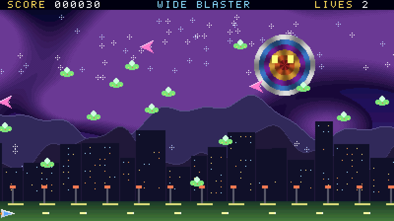
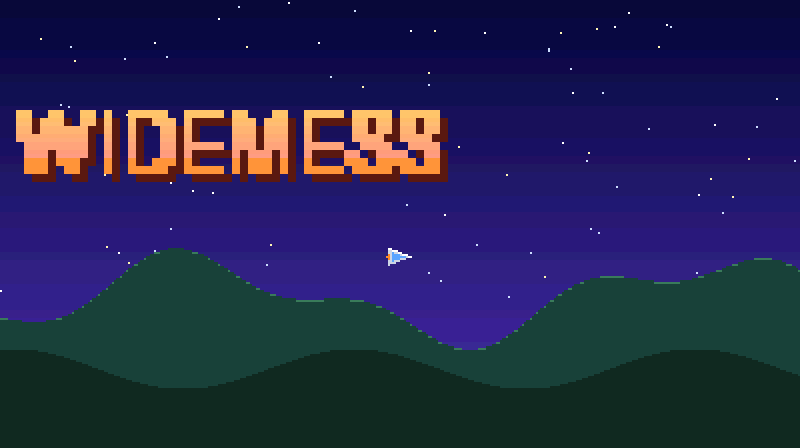
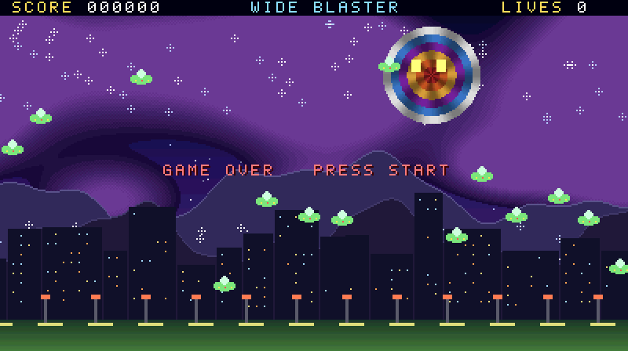
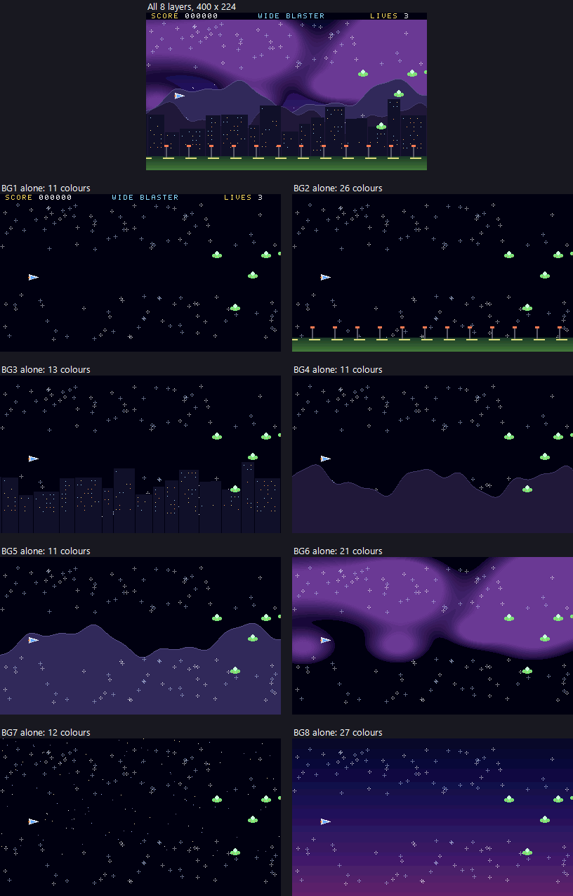

# The WideMess devkit (milestone 5)

How to make a game for WideMess, BrokenNes's souped-up SNES fantasy console, with BrokenDev. The hardware contract is
`docs/projects/widemess-spec.md` (spec v1); the plan is `docs/projects/widemess-plan.md`.

The devkit is **PVSnesLib with WideMess extensions**, the toolchain Super VRUN already uses (816-tcc C and WLA-DX 65816), plus
converters, a sound driver for the bigger sound chip, a project template and a sample game. It lives in `BrokenDev/widemess/`; the sample
game is `WideMess/sample/`. PVSnesLib itself is the user's copy in the Super VRUN workspace (`SuperVRUN_dev/snes-stub/toolchain/pvsneslib`),
which the devkit only reads.



## Start a game

```powershell
BrokenDev\brokendev.ps1 new widemess my-game              # the template, in BROKENDEV_HOME\projects\my-game (or -Path <folder>), -Title "MY GAME"
BrokenDev\brokendev.ps1 build my-game                     # converters, C, assembly, link, .wms: out\my-game\my_game.wms
BrokenDev\brokendev.ps1 verify my-game                    # runs it on the WideMess console and checks what it shows (below)
BrokenDev\brokendev.ps1 run my-game                       # opens it in the BrokenNes desktop app (brokendev build-app first)
BrokenDev\brokendev.ps1 compat my-game                    # BrokenNes's column only: no other emulator runs WideMess
```

`new widemess` copies `BrokenDev/widemess/template` into the project's folder with its name filled in, and writes its manifest,
`BrokenDev/projects/<name>/project.json` (from `BrokenDev/widemess/template.project.json`: kind and console `wms`, `source.folder` = the
project's folder). It refuses a name that is taken, a folder that is not empty and a name that is not lower-case letters, digits and dashes.
Without BrokenDev, `BrokenDev\widemess\tools\wmsbuild.ps1 -Project <folder>` builds the same thing (it finds PVSnesLib through
`BROKENDEV_PVSNESLIB` or beside the repository, the Workshop through `BROKENDEV_WORKSHOP`).

A project:

| Path | What |
|---|---|
| `wms.json` | the game: `name` (the ROM's file name), `title`, `romBanks` (64 KB banks, 2-64), `fastRom`, `features` (what the `.wms` header asks for: `picture`, `sprites`, `sound`, `fastcpu`, `bigwram`, `fastdma`), `sramBytes` and `battery` (a save), `graphics` and `sound` (the converters' inputs, below) |
| `src/*.c`, `src/*.asm` | the game, in C (816-tcc) and 65816 (WLA-DX); every file is built |
| `src/far.asm` | the game's work RAM above the SNES's 128 KB (below) |
| `gfx/`, `audio/` | PNG, WAV and MIDI sources |
| `build/` | everything the build writes: `<name>.wms` (the game), `<name>.sym` (symbols), `<name>.sfc` (the bare image), `gen/` (the converters' output: `gfx.h`, `snd.h`, the data), `logs/` |

The template shows one of each feature: three of the 8 layers at 400 x 224, a sprite moved by the d-pad, a song and an effect on the
WideMess sound chip, fast mode, and a counter in the far work RAM. A SNES (or an emulator without WideMess) gets a red screen.



## The library (`BrokenDev/widemess/lib`)

`#include "widemess.h"` (and `"wmssound.h"` for sound). Every register of the spec is a `REG_WM...` macro; the calls:

| Call | What (spec section) |
|---|---|
| `wmsInit()`, `wmsHas(features)` | the unlock and the ID check; 1 on a WideMess. `wms_features` holds `WMFEAT` (1) |
| `wmsFastCpu(on)`, `wmsFastDma(on)` | 10.74 MHz; a DMA byte every 4 master clocks (2) |
| `wmsScreen(WMCTRL_WIDE \| WMCTRL_LAYERS8)`, `wmsLayersMain(mask)` | 400 wide, the 8-layer mode; the layers on the main screen (3) |
| `wmsLayer(n, mapAddr, cfg)`, `wmsScroll(n, x, y)`, `wmsScrollNow` | a layer's map, `WMS_MAP_*`, `WMS_BANK(b)`, `WMS_TILES(unit)`; its scroll (kept and written in vblank, or at once) |
| `wmsVramCopy`, `wmsVramFill`, `wmsPalCopy`, `wmsColor` | DMA into the 512 KB of video RAM and the 1,024 colours |
| `wmsUpload(table)` | a whole upload table: maps, tiles, colours, layer settings, `WMTM`, work RAM, sound RAM (the converters write one) |
| `wmsSpritesInit(unit)`, `wmsSpritesShow(on)`, `wmsSpriteSet(id, x, y, tile, attr6, attr7)`, `wmsSpriteMove`, `wmsSpriteHide`, `wmsSpriteHideFrom`, `wmsSpritePri` | the 256-sprite table (3.3), kept in work RAM bank `$70` and uploaded by `wmsVblank()` when it changed; `WMS_SPR_*` attributes |
| `wmsVblank()` | call it from the NMI handler (`nmiSet`): the sprite table and the scrolls |
| `wmsWramAddr`, `wmsWramCopy`, `wmsWramFill` | the 1 MB work RAM through the 20-bit WRAM port (2) |
| `wmsSoundCopy`, `wmsSoundFill` | the 1 MB sound RAM through the main CPU's port (4) |
| `sndInit()`, `sndPlaySong(n)`, `sndStopSong()`, `sndPlayEffect(n)`, `sndPlayEffectOn(n, voice)`, `sndVolume(v)`, `sndChannels()` | the sound driver (below) |

**The rules the library keeps, and a game should:**
- Video RAM, colours and the sprite table are written in vblank or forced blank (spec 3): the copy calls run their DMA at once, so call
  them in forced blank (`setScreenOff`) or from the NMI handler.
- DMA channel 0 is the main program's, channel 1 `wmsVblank()`'s, channel 7 PVSnesLib's (its OAM copy). Keep HDMA off those.
- `-D WMS_NOUNLOCK` builds a game that skips the unlock and writes every WideMess register anyway: the negative control the checks use.

**The memory map** (`lib/wmshdr.asm.in`, written as `build/hdr.asm`). A WideMess game is on the WideMess map (game-file map 2): ROM in
64 KB banks at `$C0-$FF` with HiROM mirrors, so PVSnesLib's HiROM libraries and its HiROM memory map are used as they are (wlalink refuses
objects "compiled for different memory architectures", so the map cannot gain a slot). The far work RAM, banks `$70-$7D`, is reached
through PVSnesLib's SLOT 3 with the bank in the section, after `.BASE $00`:

```asm
.include "hdr.asm"
.BASE $00                              ; hdr.asm sets .BASE $C0 for the code, and WLA adds it to a RAMSECTION's bank too
.RAMSECTION "my_far" BANK $71 SLOT 3
my_table dsw 20000
.ENDS
```

C sees it as an ordinary array (`extern s16 my_table[];`): 816-tcc addresses globals with long addressing, so the section's bank is used.
Bank `$70` `$0000-$07FF` is the library's sprite table; the rest of `$70-$7D` (896 KB) is the game's. Battery RAM is PVSnesLib's SLOT 4
(`$20-$3F:6000-7FFF`). The minimum ROM is 2 banks (PVSnesLib's libraries were assembled with 2).

**816-tcc's traps** (each cost a crash or a failed link while the library was written; the library avoids them, a game should too):
- a pointer made from a computed address (`(vuint8 *)(0x21D0 + n)`) gets a stale bank: index registers in 65816 (as `wmslib.asm` does);
- `(u32)pointer` keeps only the 16-bit address, sign-extended: pass pointers as pointers;
- a function that reads a `u32` parameter needs a local variable, or the link fails ("Unresolved reference to `__<function>_locals`");
- in WLA, give a subroutine label its `.ACCU` / `.INDEX` when the code before it ends in another mode, or an immediate assembles at the wrong size;
- in the SPC700, `incw` sets N and Z: test a byte after reading it, not after the increment.

C is slow: a hot loop belongs in 65816 (the sample's bullet test, `WideMess/sample/src/game.asm`, and the library's sprite routines are).
The arguments' layout for an assembly routine called from C is at the top of `wmslib.asm`.

## The converters (`BrokenDev/widemess/tools`)

`wmsbuild.ps1` runs them on `wms.json`; each also works alone (`python wmsgfx.py` / `python wmssnd.py` print their usage).

**`wmsgfx.py`: PNG to the picture's formats.**

```json
"graphics": {
  "backdrop": "#000010",
  "layers":  [ { "name": "sky", "png": "gfx/sky.png", "layer": 7, "bank": 0, "map": "64x32", "priority": false } ],
  "sprites": [ { "name": "ship", "png": "gfx/ship.png", "frame": "16x16", "bpp": 4, "palette": 48 },
               { "name": "boss", "png": "gfx/boss.png", "frame": "64x64", "bpp": 8, "bank": 3 } ]
}
```

- **Layers:** 8-bpp tiles in the SNES's planar format (the same bytes as PVSnesLib's gfx4snes, which BrokenDev's tests check) and a
  WideMess map (row by row; tile 0-4095, priority, flips), deduplicated with flips across all layers, in one tile pool of up to 4,096 tiles.
  The map is the image's size rounded up to 64 or 128 x 32 or 64 tiles, or `map`.
- **Sprites:** frames of 8 to 64 pixels in 4 or 8 bpp, laid out in the WideMess sprite sheet (16 tiles wide: a sprite's tile (tx, ty) is
  tile + ty x 16 + tx).
- **One palette of up to 1,024 colours:** four banks of 256. A 4-bpp sprite owns its 16 entries (`palette` 0-63); layers and 8-bpp sprites
  that name the same bank share it. A bank holds 255 colours (colour 0 is transparent), a 4-bpp sprite 15: more is an error that names the
  bank and who shares it, unless the asset says `"quantize": true`.
- **Video RAM:** maps from `$00000`, the layers' tiles from the next 64 KB unit, the sprites' tiles after them.
- **Out:** `gen/gfx.h` with each layer's `GFX_<NAME>_LAYER`, `_MAP`, `_CFG`, `_W`, `_H`, each sprite's `GFX_<NAME>_TILE(frame)`, `_ATTR6`,
  `_ATTR7`, `_FRAMES`, `GFX_SPRITE_UNIT`; `gfxLoadAll()` uploads everything (maps, tiles, palette, layer settings, `WMTM`) in forced blank.

**`wmssnd.py`: WAV and MIDI to the sound chip.**

```json
"sound": {
  "samples": [ { "name": "pad", "wav": "audio/pad.wav", "format": "pcm16", "rate": 32000, "root": 57, "loop": 16000, "adsr": ["8A", "E0"] },
               { "name": "kick", "wav": "audio/kick.wav", "format": "brr", "rate": 16000 } ],
  "songs":   [ { "name": "theme", "mid": "audio/theme.mid", "volume": 0.2,
                 "instruments": { "1": "pad", "9": { "36": "kick", "38": "snare" } } } ],
  "effects": [ { "name": "laser", "sample": "laser", "voice": 0, "volume": 60 } ]
}
```

- **Samples:** any PCM WAV (mixed to mono, resampled to `rate`). `pcm16`: signed 16-bit, whole groups of 4 samples, the loop on a group,
  peaks kept within the spec's ±32,700. `brr`: through PVSnesLib's `snesbrr` (the loop on a 16-sample block). `root` is the MIDI note the
  sample sounds at its own rate; `adsr` the S-DSP's ADSR1 and ADSR2.
- **Songs:** a standard MIDI file (format 0 or 1, tempo changes, velocity, CC 7 and 10). Each MIDI channel with notes names a sample or a
  **drum kit** (MIDI note -> sample, each played at its own pitch). Notes are given to the driver's 24 channels as they sound; time is
  quantised to the driver's tick (160 a second). Errors, never silent drops: more than 24 notes at once, a pitch above 4x, a channel without
  an instrument, more than 128 distinct notes in a song.
- **Effects:** one note of a sample on one voice. Voices 0-7 (the S-DSP's own) play BRR samples below 64 KB only; voices 8-31 anything.
- **Out:** `gen/snd.h` (`SND_SONG_<NAME>`, `SND_SFX_<NAME>`, `SND_SAMPLE_<NAME>`) and the whole sound RAM image as an upload table.

**Composing in FL Studio:** export the song as a MIDI file and name it in `songs`; the converter's messages say what it could not keep.
(The BrokenNes2 plugin's *Test MIDI export* replays a song in VRUN's NES engine; hearing the WideMess voices from FL is milestone 7's
instrument.) `python wmssnd.py midi song.mid` reports the channels, the length and the most notes at once.

## The sound driver (`BrokenDev/widemess/driver/wmsdrv.asm`)

An SPC700 program for the WideMess sound unit (spec 4), about 1 KB. `sndInit()` loads it, the songs and every sample through the main CPU's
sound RAM port while the boot loader runs (the SPC700 copies nothing: the main CPU fills the 1 MB), then starts it with the boot loader's
jump. It answers `$5A` on port 1 and the WideMess ID on port 2 (`sndInit()` returns 0 without a WideMess sound unit).

- **Songs** play on up to 24 channels, voices 8-31 (bank by bank through `WBANK`), each with its pitch table entry, instrument (SRCN, ADSR,
  GAIN) and volume; channels loop together.
- **Effects** play on any of the 32 voices, at once.
- **Commands** (`wmssound.c`): ports 1-3 = command and two values, port 0 = a new id; the driver echoes the id when done. 1 play a song,
  2 stop, 3 an effect (on its voice or another), 4 the master volume. Port 3 reports the channels still sounding.
- **Sound RAM:** `$00200` the driver, `$01000-$07EFF` the songs and tables, `$07F00` the S-DSP's directory, `$08000-$0FEFF` BRR samples
  (both directories list them), `$10000` the WideMess directory (256 entries of 16 bytes), `$11000-$FFFFF` 16-bit PCM (and BRR that did not
  fit below 64 KB). Echo is off.

## The checks

**BrokenDev `verify`** runs a WideMess project on the WideMess console (`console: wms`) and checks its `expect.wms`, measured from outside
the game (Workshop's `WideMessCli.Measure`):

| Key | Checks |
|---|---|
| `unlocked`, `width`, `layers8`, `fastCpu` | the console's state at the last frame |
| `minLayers` | layers that draw something when drawn alone |
| `minSprites` | WideMess-table sprites on the picture |
| `minBigWramBytes` | non-zero bytes of work RAM above the SNES's 128 KB |
| `minVoices`, `minVoiceFrames` | the most of voices 8-31 sounding in one frame, and the frames with any, from `audio.fromFrame` |

`compat` has a BrokenNes column for WideMess projects (`--brokendev run` takes console `wms`; the other emulators say they do not run it).

**`Workshop --wms-run --rom game.wms [--frames N] [--input "f:Buttons,..."] [--png-at f,...] [--out-dir d] [--voices] [--wram ADDR:LEN] [--ram-trap] [--trap-pc BBXXXX]`**
reports what a game uses (the same measure), the sound unit, the audio and where the CPU spent the last 30 frames; `--ram-trap` stops at
the first instruction fetched from RAM (a crash) and lists the 64 before it.

**`Workshop --wms-test`**, section M5, on the test ROMs `WideMess/testroms/devkit/build.ps1` builds with the devkit (template, sample,
and their negative controls): see `WideMess/README.md`. **`BrokenDev/tests/run-tests.ps1`**, section *widemess devkit*, tests the
manifests, `new widemess`, the converters (against gfx4snes, with their refusals) and a project made by `new` built and verified end to end,
each with a negative control.

## The sample game: Wide Blaster (`WideMess/sample`, project `widemess-sample`)

A small horizontal shooter made with `brokendev new widemess widemess-sample`, then grown, on every feature:

- **8 layers** of 256 colours at 400 x 224 in parallax: the HUD (in front, its digits and its game-over line copied from parts of its own
  map that are off the picture), the road, the city, two mountain ranges, a nebula, the stars, the sky; 960 tiles, 158 colours.
- **The 256-sprite table:** the ship, 24 bullets, 20 enemies, 32 explosions, a 64 x 64 256-colour boss and 120 sparkles: up to 199 at once,
  about 145 on the picture in play.
- **The sound chip:** a song on up to 12 of voices 8-31 (16-bit PCM bass, pad and lead; BRR drums through a drum kit), a laser on voice 0
  (BRR, an S-DSP voice), explosions on voices 30-31 (16-bit PCM).
- **Fast CPU and fast DMA:** the game's C keeps 60 frames a second in fast mode; at SNES speed (`-D SAMPLE_SNES_SPEED`) a game frame takes
  about 2.5 vblanks.
- **The 1 MB work RAM:** every actor pool, the enemies' flight path and a 64 KB flight recorder of the pad (`src/far.asm`).

Controls: the d-pad flies, B or Y fires, Start restarts after the game is over.




Its 8 layers, each drawn alone (`Workshop --wms-sheet`; the sprites are drawn in every panel):



## What is not there yet

- Echo, pitch modulation and noise are not driven by the sound driver (the chip has them; a game can write the DSP itself), and songs
  cannot be streamed: they must fit the 28 KB bank. The driver's effects do not steal a song's channel back when they end.
- No widescreen SNES modes in the library (a game can write `WMCTRL` = WIDE and the SNES registers itself), and no window or colour-math
  helpers: the registers are all in `widemess.h`.
- The converters do not compress, and `wmsgfx` has one tile pool of 4,096 tiles for every layer.
- WideMess games open in the desktop app; Lite and the FL plugin run them from milestone 7.
